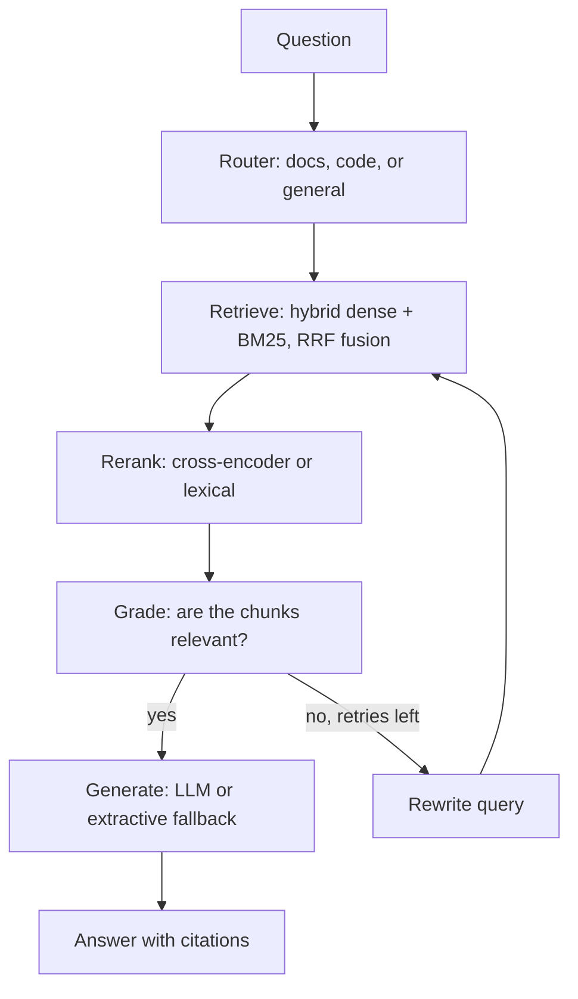

# Advanced RAG Agent

One retrieval-augmented generation system with two lanes, document QA
and code search, behind a single LangGraph agent. It ingests Markdown,
text, PDF, and Python files, retrieves with hybrid search, reranks,
grades its own results, retries with a rewritten query when the first
pass fails, and answers with citations.

Local-first and free only. No paid APIs anywhere. The LLM is optional:
without an `OPENROUTER_API_KEY` the agent answers with an extractive
fallback that quotes the retrieved chunks.

## Quickstart

```bash
git clone https://github.com/saifullah-ai-engineer/advanced-rag-agent
cd advanced-rag-agent
python -m venv .venv
source .venv/bin/activate
pip install -e .
```

Try the demo first. It needs no key and no model download:

```bash
rag-agent demo
```

Then index your own files and ask questions:

```bash
rag-agent ingest ./docs
rag-agent ask "How do I install advanced-rag-agent?"
rag-agent eval
```

## How it works



1. **Ingest.** Markdown and text files are chunked recursively with
   overlap, keeping markdown headings attached to each chunk. Python
   files are chunked with the AST, one chunk per function or class, with
   a line-window fallback for anything the parser cannot handle. PDFs
   are read page by page with `pypdf`.
2. **Embed.** The default embedder is `all-MiniLM-L6-v2` from
   sentence-transformers when the ml extra is installed. Without it, the
   system falls back to a deterministic hash embedder and prints a clear
   warning. The hash embedder is what the tests and the demo use.
3. **Store.** Chunks and embeddings live in a single SQLite file. Dense
   search is cosine similarity with numpy. A BM25 index is built over the
   same chunks.
4. **Retrieve.** Dense and BM25 results are fused with reciprocal rank
   fusion, then reranked. A cross-encoder reranks when the ml extra is
   installed; otherwise a lexical overlap reranker is used.
5. **Correct.** Retrieved chunks are graded. If none is relevant, the
   query is rewritten and the search runs again, up to 2 retries.
6. **Generate.** With an OpenRouter free model configured, the answer is
   generated from the retrieved chunks with citations. Without a key, an
   extractive fallback composes the answer from the best matching
   sentences in the top chunks.

## The two lanes

The router classifies every question before retrieval:

| Lane | Trigger | What is searched |
| --- | --- | --- |
| docs | install, guide, what is, how to, config | Markdown, text, and PDF chunks |
| code | function, class, method, error, implement | Python chunks, split by definition |
| general | anything else | Both lanes together |

A docs question never wastes retrieval budget on code chunks, and a code
question searches definitions, not prose. The demo asks two docs
questions and one code question to show both lanes working.

## Configuration

| Setting | Default | Environment variable |
| --- | --- | --- |
| Chunk size | 800 chars | `RagConfig(chunk_size=...)` |
| Chunk overlap | 150 chars | `RagConfig(chunk_overlap=...)` |
| Top-k retrieved | 5 | `RagConfig(top_k=...)` |
| Reranked to | 3 | `RagConfig(rerank_top_k=...)` |
| Max retries | 2 | `RagConfig(max_retries=...)` |
| Embedding model | all-MiniLM-L6-v2 | `RagConfig(embedding_model=...)` |
| Store path | rag.db | `RAG_DB_PATH` |
| LLM model | google/gemma-4-26b-a4b-it:free | `OPENROUTER_MODEL` |
| LLM key | unset | `OPENROUTER_API_KEY` |
| Force hash embedder | off | `RAG_EMBEDDER=hash` |

Only free OpenRouter models are accepted. A model name without `:free`
is refused at startup.

## Evaluation

`rag-agent eval` runs the shipped eval set through the agent and reports
four metrics in the RAGAS spirit, all computed locally: faithfulness,
answer relevancy, context precision, and context recall, plus keyword
coverage against the expected terms in `examples/eval_set.json`.

## Honest limits

- The local SQLite store is fine to roughly 10,000 chunks. Past that,
  dense search slows down because it scans the whole embedding matrix,
  and a real vector database would be the right move.
- The extractive fallback is not a real LLM answer. It quotes the most
  relevant sentences from the retrieved chunks. It is grounded and
  honest, but it does not synthesise, compare, or reason across chunks
  the way a model does.
- The cross-encoder reranker needs sentence-transformers installed. The
  lexical reranker that replaces it is fast and deterministic, but it
  only sees shared words, not meaning.
- The hash embedder is a bag of hashed words. It works offline and keeps
  the tests fast, but it has no real semantics: two chunks that use
  different words for the same idea look unrelated to it.
- Query rewriting without an LLM is keyword expansion, not
  understanding. It helps with phrasing mismatches and does nothing for
  genuinely ambiguous questions.
- Eval scores on the shipped 5-item set are a smoke signal, not a
  benchmark. They show the pipeline works end to end; they say nothing
  about quality on a real corpus.

## Development

```bash
pip install -e '.[dev]'
python -m pytest
```

## Contributing

See [CONTRIBUTING.md](CONTRIBUTING.md). If you used AI assistance, say
so in one line in the pull request description.

## License

MIT. See [LICENSE](LICENSE).
